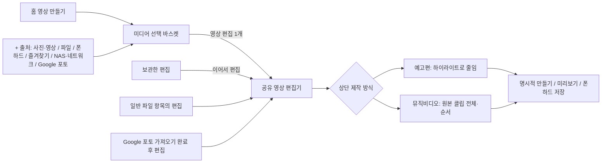

# NasFinder 미디어 업무 흐름 정리 — 2026-10-17

## 범위와 상태
- 사용자 승인: 중복 영상 제작 진입 통합, 미디어 출처 확장(+ 메뉴에 즐겨찾기 포함), 브라우저 음악 감지·파일명·알림 닫기 수정, Mac·iPhone·Android 정상 빌드·데이터 유지 교체 설치·재실행, 실제 소스에 맞는 중앙 시작 A4 지도.
- 작업자: TM Codex / 구현 Claude Sonnet5.5(low). Gemini CLI는 이 세션 실제429 한도 소진을 확인하여 Claude로 배정. 같은 논리 업무의 라우팅 재사용, 외부 조사 비적용(로컬 결정론적 변경).
- 시작16:51 KST, 종료/최종 설치는 아래 최종 증거에 추가. 중간2.14.1 설치 완료 후 사용자 즐겨찾기 요청으로2.14.2 추가 진행 중.
- 기존 사용자 변경·원본 보존, 테스트·테스트 러너·린트 미실행(별도 요청 없음). Git 커밋·푸시·외부 릴리즈·TestFlight·홈페이지 변경 없음.

## 바뀐 흐름

기존: 홈에서 예고편/뮤직비디오 선택 팝업 → 미디어 선택에서 다시 두 제작 버튼 → 별도 명칭의 편집 진입.
현재: 홈 영상 만들기 → 미디어 선택 → 영상 편집 → 편집 옵션 상단 제작 방식 한 줄. 모드 변경 자체는 파일 생성이나 저장된 편집 덮어쓰기를 하지 않는다.

## 메뉴 정리 판단
- 예고편·뮤직비디오는 같은 미디어/음악/출력 옵션을 공유하므로 독립 섹션 대신 편집기 안의 제작 방식으로 합쳤다. 차이는 장면 배분(하이라이트/전체 클립)이다.
- 보관한 편집은 생성 결과 파일이 아니라 이어서 수정할 작업이므로 독립 목록으로 남겼다. 저장 개수 제한·자동 삭제 없음.
- 내 사진·영상은 감상·선택·폰하드 복사에도 쓰는 바로가기이므로 유지했다. 같은 선택 화면으로 합류하는 것 자체를 중복 기능으로 보고 없애지 않았다.
- 폰하드는 기기 내부 저장 파일, 네트워크/Google 포토는 외부 원본이다. 원본 이동 대신 필요한 선택 항목을 기존 경로로 가져와 바스켓에 더한다.
- 일반 파일 브라우저와 Google 포토 완료 화면의 편집 바로가기도 공유 편집기로 합류한다. 이 경로들은 지도에서 생략하지 않고 선으로 표시했다.

## 동작과 보존 경계
- 출처 전환·취소 시 이미 담은 목록/순서를 유지. 동일 출처 동일 항목 식별만 중복 방지하며 다른 공급자 파일을 해시로 추정 병합하지 않는다.
- Apple: 폰하드/가져오기 완료 URL은 읽기 전용 재사용, 직접 만든 임시 복사본만 정리. 선택 중 브라우저/프리뷰/편집기는 수명 가드 적용.
- Android: 미디어 화면 SaveableStateHolder와 명시적 전달을 사용. 네트워크는 선택한 파일만 바스켓 전용 캐시에 복사. 캐시 수명은 기존 앱 캐시 정책이며 원본은 삭제하지 않는다. 폴더를 이동하기 전 아직 추가하지 않은 체크는 폴더 단위다. 폴더별로 추가하여 하나의 최종 바스켓에 합칠 수 있다.
- Google 포토: Apple 기존 가져오기 흐름 재사용, Android 기존 클라우드 지원 시스템 선택기 재사용. 신규 OAuth/API 연결/계정 권한 변경 없음.
- 모드 전환: 입력/순서/BGM/오토덕킹/출력 옵션 유지. 예고편 분석 실패는 이전 모드 유지, 비동기 완료는 현재 세션 식별로 제한. 실제 출력은 만들기 선택 후 생성.
- 브라우저 음악: 후보별 URL/자기 제목/재생상태를 함께 보관, 클릭 시 불변 스냅샷 다운로드. SPA 재생 이벤트에서 후보 교체/재스캔; 오래된 감지 결과는 버린다. 쿼리 포함 식별로 stream?id=A/B 구분, 원본 요청 URL 보존. 현재 감지 알림X/성공 후 소비, 같은 곡 일시정지·재개로 부활하지 않음. 진행 중 다운로드 취소와 독립.
- 제목 기반 안전한 파일명, 문자소/UTF8 길이 제한, 서버이름 fallback, 오디오 MIME 확장자 보정. 음악 요청만 캐시 재사용 방지. 보안/쿠키 설정을 약화하지 않았다.

## 직접 관찰한 사실
- 2.14.0 Mac: 영상 만들기에서 초기 모드 팝업 없이 선택 화면 진입. 하단 영상 편집 한 개. +의 기존5종 출처, 실제 저장 NAS 연결 루트 탐색 관찰.
- Mac 임시 UI 선택1개 후 NAS 탐색·돌아오기에서도 선택1개 유지. 그 선택만 해제하고0개로 복귀, 파일 복사/내보내기/편집 저장은 하지 않음.
- 2.14.1 Mac: 내 사진·영상 홈 바로가기 복원 확인. 영상 만들기 헤더 오류를 발견해 해당 링크의 initialMode만 수정. 17:26 실제 헤더 영상 만들기, 바스켓0개, 하단 영상 편집 한 개 확인 후 홈 복귀.
- 2.14.1: Mac / iPhone 메인 앱과4개 포함 확장 버전/빌드 일치, Android 설치 base.apk와 빌드 APK SHA256 일치 직접 확인(17:18). 그 뒤 Apple 제목 수정 동일 버전 재설치.
- MP3 자세히 시간표시의 이전 직접 관찰: 0:00→0:10→0:16 /3:28, 정지 시16초 유지. 이후 해당 동작 변경 없음.

## 미확인
- 실제 사용자 음악 사이트에서 곡A→B 다운로드 파일 내용/파일명. 사이트 주소/현재 페이지는 제공되지 않았으며 재현 확인 완료로 주장하지 않는다.
- Google 포토 인증 완료→NAS/즐겨찾기 혼합 바스켓→최종 내보내기 전 과정.
- Android 변경 화면의 실기기 조작/렌더링 대조와 Apple/Android 전 화면 픽셀 동등성.
- 별도 계측·테스트 실행 없음. 실제 기능의 최종 사용 판단은 사용자 확인 대상.

## 복구/관찰 누락 기록
- Gemini429 한도 → 승인 범위 Claude 구현 인계.
- 일부 Claude BSD sed-i 실패 → Edit/Python으로 실제 변경 후 재빌드. Mac 제목은 TM 실제 화면에서 발견해 링크 한 곳 수정. 실패한 첫 빌드만으로 반영 완료를 주장하지 않음.
- Mac 종료 거절·기존 프로세스 잔류 → 팝업 닫고 홈/선택0 상태 확인 후 정확한 이전 앱 PID만 TERM, 교체·재실행. 광역 종료/데이터 초기화 없음.
- 브라우저 새 웹 브리지/파일명 변경은 TM 독립 읽기 검토를 한 번 수행: 쿼리 생략 식별/일시정지 닫기/신호 호출량/UTF8 길이 문제를 확인해 수정. 이후3대상 빌드·설치.
- unified_media_selector 계약 일부는 최초 코드 뒤에 기록한 순서 누락. 이후 범위 문서 정정. favorites는 계약 먼저 갱신하도록 배정.
- 계약 따옴표 오류는 정정 후 Ruby YAML 파싱 성공(번들 Python에PyYAML없어 표준Ruby재사용). 의존성 설치 없음.
- 전체 흐름 분석 CLI 응답 일부 수집 실패: 전체 저장소 감사 완료로 주장하지 않으며 실제 도달 경로/스코프 소스/화면 관찰만 근거로 사용.
- 매치업 이력 구조 처음 누락필드 observed_by/description 발견→정정.81행 구조 통과,4완료77열림. 기존 미검증행은 지우지 않음. 이는 구현/빌드 실패가 아니라 전체 렌더링 일치 증거가 없다는 경계다.
- 지도 보정 중 시스템Python에reportlab없음→제공 런타임 사용.2.14.1 PDF동일내용재생성 발생, 최종본2.14.2별도파일 제공. A4한페이지/중앙시작/공유 합류 실제 PNG확인.
- 사용하지 않은 자체 임시 합성 파일2개만 안전하게 제거. 사용자 저장 파일/원본 변경 없음. PhoneHard 사용량 변화는 사용자 동시 활동 가능성이 있어 이번 작업으로 단정하지 않음.

## 최종 증거
2.14.2 구현·빌드·설치·Mac 메뉴 확인 결과는 아래 최종 설치 절에 기록했다.

## 지도 최종 레이아웃 확인
- TM17:26 PNG눈으로 확인: 제목2.14.2, 즐겨찾기출처 포함, 중앙시작, 같은화면 합류, 외곽여백/문자잘림 없음.
- pypdf 메타데이터:1페이지,297.0×210.0mm(A4가로),69252바이트. 지도는 현재Mac소스 기준; Android픽셀동일성 주장없음.
- 이전 지도 보정 작업이 남긴 자체 reportlab 검색 find프로세스(PID91963)만 정확히 확인 후TERM종료, 새 의존성 설치 없이 제공 런타임 사용.

## 2.14.2 빌드 실행기 종료 지연 복구
- Mac /tmp/fav-mac.log에는 BUILD SUCCEEDED, 생성 앱2.14.2(202610171727),17:35codesign --verify --deep --strict exit0 확인. 빌드 xcodebuild PID93254가 종료 상태?E에서2분이상 잔류하여 정확한 해당 프로세스와 lockf93247만TERM. wrapperexit143, 컴파일실패나exit0으로바꿔보고하지않음. 산출물 검증과 나머지OS빌드/설치는별도기록.

## 최종 설치·확인 결과 (2.14.2)
- Apple2.14.1→2.14.2, build202610171708→202610171727; Android2.14.1/416668→2.14.2/416669.
- Mac Catalyst/iOS 실제 BUILD SUCCEEDED, 단 위 종료 지연 복구로 wrapperexit143. 두 앱 codesign --verify --deep --strict 각각exit0. Android assembleDebug exit0,46초.
- Mac 기존 앱 종료·데이터 유지 교체·재실행 PID97033. /Applications 설치 앱2.14.2/202610171727 직접 확인.
- iPhone 지정 기기 install/launch 성공, devicectl info apps 직접 확인2.14.2/202610171727. iOS 앱과4개 포함 확장 버전/빌드 모두 일치. 다른 아이폰은 변경하지 않음.
- Android192.168.0.253:39513 install-r Success, 재실행PID13122, versionName2.14.2/versionCode416669 직접 확인. 빌드APK/설치base.apk SHA256 둘다3abedb8b1cc0a94971abcc6b1cbdd089e31c7277278ad7a1acfde188a04d355f 일치.
- Mac CUA17:39: 홈 영상 만들기 바로 진입, 헤더 영상 만들기, 하단 영상 편집1개. +메뉴 사진·영상/파일/폰하드/즐겨찾기/NAS·네트워크/Google 포토 순서 확인. 즐겨찾기 실제 기존 폴더 목록→그 폴더의7개하위폴더와미디어담기선택기(0개) 진입→즐겨찾기→영상 만들기(0개)→홈 복귀. 원본/즐겨찾기 수정·새 파일 복사·편집 저장 없음.
- 즐겨찾기 파일 직접 추가, 폰하드 즐겨찾기 폴더, 이동/삭제/접속실패, Google/NAS혼합내보내기 실제 조작은 미확인. Mac폴더진입확인을 전체 실제파일반환검증으로 확대하지않음.
- 구현 보고: 2026-10-17-favorites-media-source.md / Android .parity/favorites-media-source-2.14.2.md. 작업자 종료시각 표식17:40은 실제 수신17:39보다 앞서 있으므로 TM실제시계기록을 우선.
- 최종 문서·메뉴 의견과 A4한페이지 중앙시작 지도 전달. 전체픽셀매치업은82행중4완료78열림(즐겨찾기행포함; 최종validator결과별도). 사용자별실제상태확인이남은행은소스구현상태로기록, 제품전체동일성/전체저장소감사완료주장없음.

## 종료
- 17:40 KST TM 종료: 승인된 소스 변경·빌드 산출물·지정3대상 교체 설치/재실행·Mac즐겨찾기진입·A4지도/메뉴의견 준비 완료. 전체기능실기기검증/전체픽셀매치업/실제문제사이트파일검증으로확대주장하지않음.
- 최종ledgervalidator: StructureOK82rows4complete78open, gateexit3. 미검증기존행보존. 기록된CLI호출일부사용량은2026-10-17-media-workflow-usage.json이며 누락호출은명시, 전체비용합계로주장하지않음.
